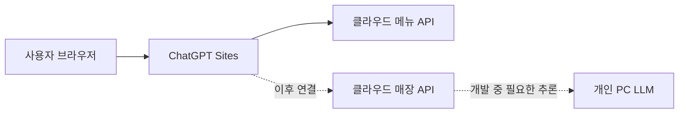

# 서비스 구조와 클라우드 이전

| 실행 위치 | 책임 | 상태 |
| --- | --- | --- |
| ChatGPT Sites | 화면과 브라우저의 동일 출처 API 경로 | 공개 데모 운영 중. 저장소에 메뉴 API 연결 코드 준비 |
| 클라우드 메뉴 API | 카탈로그·메뉴 추천·메뉴 상세 | Python 코드 준비. 배포 시 기존 API 계약 사용 |
| 클라우드 매장 API | 선택한 표준 메뉴와 지역의 매장 후보 | 다음 구현 단계. 메뉴 API와 독립된 서비스 |
| 개인 Windows PC | LLM 개발과 모델 추론 | [연결 가이드](llm-access.md)에 따라 구성 |

브라우저는 `/api/catalog`, `/api/recommend`, `/api/menus/{standard_menu_id}`를 그대로 호출한다. Sites Worker에서 클라우드 연결을 선택한다. `standard_menu_id`는 양쪽 추천 서비스가 공유한다. 매장 API는 구현할 때 `POST /api/stores/recommend`에 `standard_menu_id`와 지역을 받도록 시작한다. 브라우저 입력 중 매장 추천에 필요한 항목만 이 경로로 보낸다.

## 메뉴 API 이전 순서

1. 클라우드 서버에 이 저장소를 클론하고, 검증한 버전 태그를 체크아웃한다. 메뉴 서버 호스트가 읽을 수 있는 경로에 승인된 카탈로그를 배치한다. 운영 서비스의 상태·로그와 데이터 파일은 체크아웃과 분리한다.
2. `PICKMENU_CATALOG_PATH`에 카탈로그 절대 경로를, 서비스 비밀 저장소의 `PICKMENU_API_TOKEN`에 서버 전용 토큰을 넣는다. `python -X utf8 -u pickmenu/server.py --port 8765`로 시작한다. 실행 중인 서비스가 카탈로그를 읽도록 파일 권한을 부여한다.
3. TLS를 종료하는 클라우드의 역방향 프록시나 로드밸런서에서 위 메뉴 API 세 경로만 루프백의 8765 포트로 전달한다. 타임아웃과 요청 제한은 프록시에서 관리한다. 운영 환경에서는 해당 프로세스를 서비스 관리자로 구동하고, HTTPS를 통해 유효한 토큰이 200, 토큰 누락이 401을 반환하는지 확인한다.
4. 기존 사이트의 배포 소스 체크아웃에서 현재 `.openai/hosting.json`의 사이트 ID를 유지한다. 개발 저장소에서 `worker.js`, `build.mjs`, `package.json`을 반영하고, `export.py`를 실행한 개발 체크아웃의 `catalog.json`과 `web/`를 배포 체크아웃에 복사한다. 이 GitHub 저장소에는 생성된 카탈로그를 두지 않는다.
5. 기존 Sites 프로젝트의 런타임 환경에 `PICKMENU_MENU_API_ORIGIN=https://메뉴-API-호스트`와 동일한 `PICKMENU_API_TOKEN`을 설정한다. 주소에는 경로를 붙이지 않는다. 토큰은 Sites 비밀값으로 등록한다. 기존 사이트의 새 버전을 빌드하고 배포한 뒤 홈·메뉴 추천·상세의 응답을 확인한다. [현재 사이트](https://pickmenu-suwon-demo.jmk031204.chatgpt.site/)

이전이 끝날 때까지 사이트는 내장된 데모 카탈로그를 사용한다. 클라우드 주소를 설정한 상태에서 연결이 실패하면 메뉴 API가 503을 반환한다. 이전 버전으로 되돌리거나 Sites의 클라우드 주소를 해제한 버전을 배포하면 내장 데모로 복구할 수 있다.

매장 API를 붙인 뒤에도 메뉴 추천은 개인 PC 상태와 독립적으로 실행한다. 매장 서비스에서 LLM이 필요한 처리에는 연결 제한 시간과 실패 상태를 둔다. 서비스 로그에는 사용자 입력 원문과 모델 요청 본문을 기본 저장하지 않는다.
